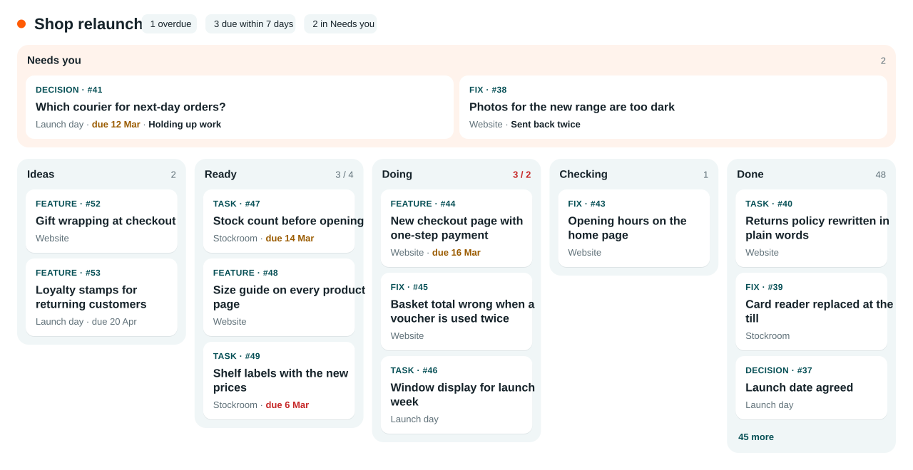

# Board Generator

Give it one file of cards. It draws the board: the cards sorted into columns, with the ones that wait for a person in a strip across the top. You get a web page where a card opens with a click, a picture (SVG) and a PDF (A4). For anyone who keeps work as cards: a person, a script, an agent or another board.



## 3 ways to use it

1. **The demo page** — <https://chalouhi.github.io/board-generator/>. Drop a file on it, choose one, or paste its text. The board appears, cards open with a click, and two buttons give the picture and the PDF. Your file never leaves the browser.
2. **The command**, for scripts and agents (Node 18 or later, no install step, no network):
   ```bash
   node bin/board.js samples/2-comprehensive.json --svg board.svg --pdf board.pdf
   ```
   With a wrong file it writes nothing, prints every problem, and ends with exit code 1.
3. **The script for other pages** — include `src/board.js` and draw a board into any element, at its width; be told when a card's button is pressed, and, if you like, hand over each opened card in full and a fresh board for a Refresh button:
   ```js
   BoardGenerator.draw(place, fileText, { onAction: (action, id, text) => { /* … */ }, getCard: id => cardText, refresh: () => fileText });
   ```

## Learn more

- **[Using Board Generator](docs/guide.md)** — every way to use it in full, what each output holds, how the board behaves, its limits.
- **[The board file](docs/file-format.md)** — how to write the file, in JSON or XML, with every field and every check; and the card file, for one opened card in full.
- **[Release notes](docs/release-notes.md)** — what each release added.

## What is in this repository

| Folder | |
|---|---|
| `src/` | The tool: `board.js` (reader, checks, the board on a page), `picture.js`, `pdf.js`, `fontsubset.js`. |
| `bin/` | The command. |
| `index.html`, `demo/` | The demo page. |
| `docs/` | The user guide and the file guide. |
| `samples/`, `expected/` | The five sample files, two card files (`cards/`), and the outputs they must produce. |
| `reference/` | The pictures of the samples approved when the look was designed. |
| `vendor/`, `fonts/` | Third-party code and fonts with their licences, so nothing needs a network. |
| `tests/` | `node --test tests/*.test.js` — runs with no network. |

MIT licence.
